# Takumi OS

**匠 Takumi** (Japanese: *artisan, master craftsman*).

Takumi OS is an opinionated Arch Linux distribution for people who are done
with macOS and Windows and want something that feels like it was built this
decade. One repository, one installer, one coherent desktop, and a different
bet at every layer of the stack.

| Layer | Takumi OS | Why |
|---|---|---|
| Root filesystem | **Atomic rooms**: every update boots a new Btrfs root, old one kept, the new one is tried once and the computer goes back to the last good one if it does not reach its login screen | Updates should never be scary, and yesterday should always be one reboot away. |
| Desktop | **The Strip**: a scrolling desktop on [niri](https://github.com/YaLTeR/niri). Windows sit side by side on an endless horizontal strip, never overlap, never need tiling knowledge | Tiling WMs ask you to learn a layout language. A strip is a thing you scroll. |
| Shell | **The Core**: the only object over your windows. A capsule of status that widens for notices, grows into the Palette on `Super+Space` (apps, windows, settings, every `takumi` command, emoji, what you copied, sentences), into Quick settings from its status marks and into Today from its clock | One object instead of a menu bar, dock, launcher, popups and settings app. |
| Keys | **Harmony**: `Super` is the universal Command key via keyd. `Super+C/V/X/Z/A/S/F/W/T/N` do the same thing in every app, terminal included | Mac muscle memory should just work on day one. |
| Look | **Phase themes and the Sky**: a theme is a palette plus four phases; the shell paints the background from it, a disc that crosses the sky over a shore of monoliths and sets at dusk. Fifty-five themes, each shown live as you move through them | A screen at 11pm should not look like a screen at 11am. |
| AI | **Intent**: Claude or OpenAI, acting only through `takumi` commands with their risk tiers. "turn off bluetooth and dim the screen" runs two audited commands; anything riskier is asked once | Assistants should act through the same audited commands a person can see, and ask before anything risky |
| CLI | **`takumi`** (alias `tk`): one router over every command in `commands/`, each describing itself in a few plain lines | The CLI is the API the Palette and Intent use. Nothing is hidden. |

## What it looks like

These are screenshots of the real system: niri, the Quickshell shell and the
login screen from this repository, running on Arch Linux ARM in the QEMU VM
(`test/vm`). The design mock in `preview/` follows the same rules.

| | |
|---|---|
| 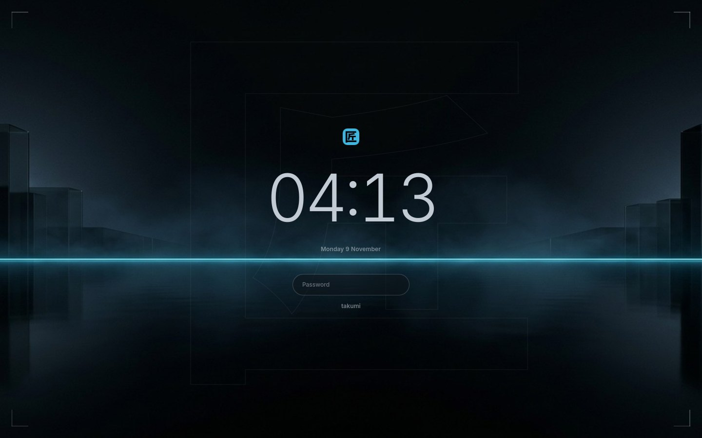 | 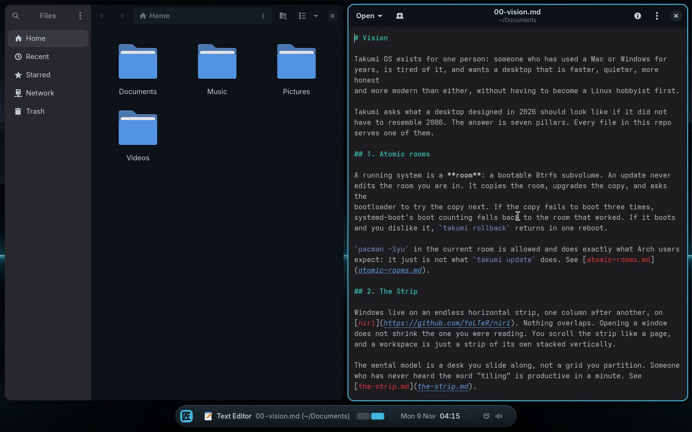 |
| The login screen: the Sky at night, the time, one field | Two apps on the Strip; the Core names the one you are in and maps the strip |
| 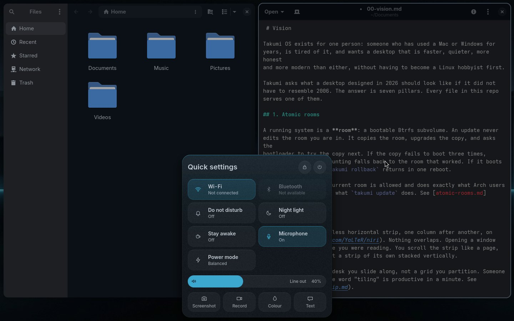 | 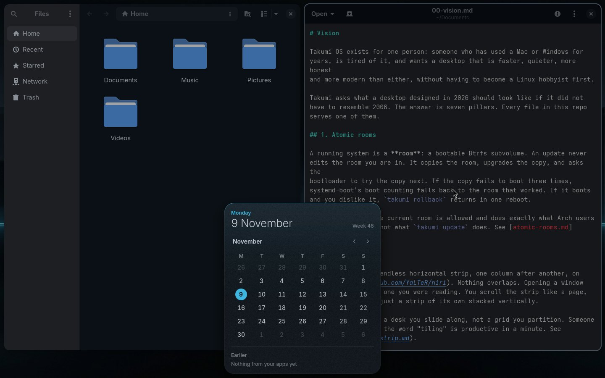 |
| Quick settings from the status marks (`Super+I`): switches, the sound, capture | Today from the clock: the month and what apps said earlier |
| 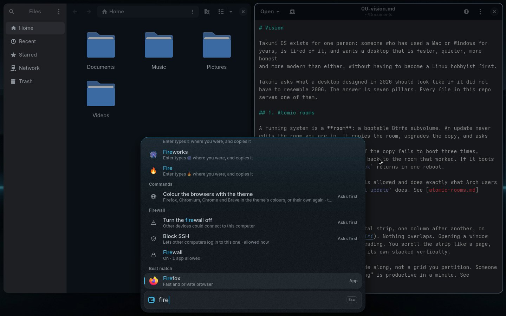 | 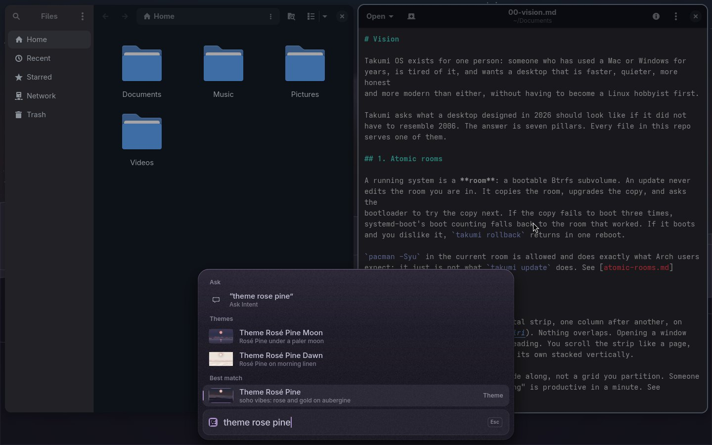 |
| The Palette rising out of the Core | Moving through themes shows each one on the shell; Esc puts yours back |
| 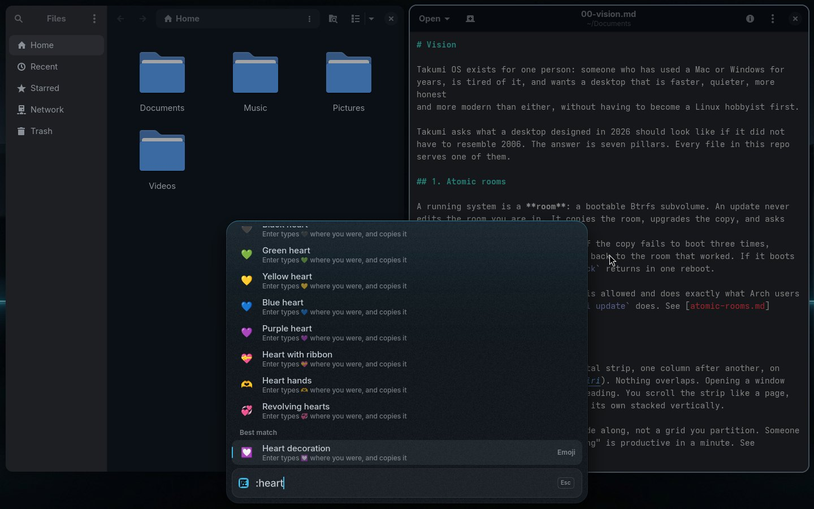 | 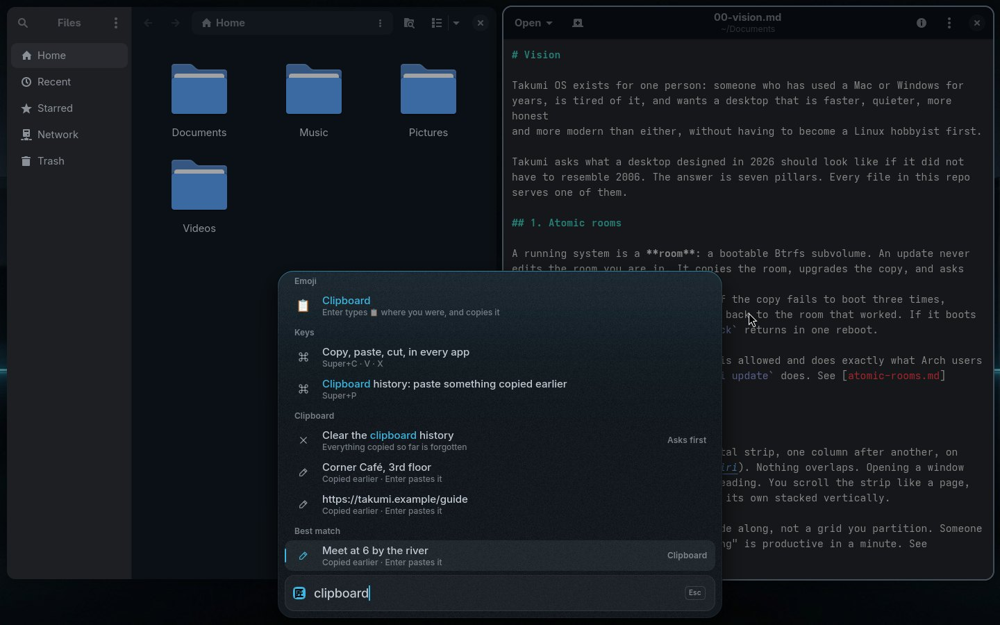 |
| Emoji by name (`Super+.`): Enter types it where you were | What you copied (`Super+P`): Enter pastes it |
| 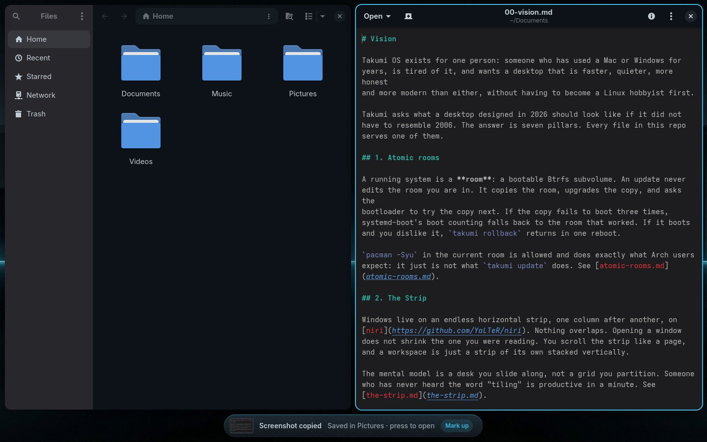 | 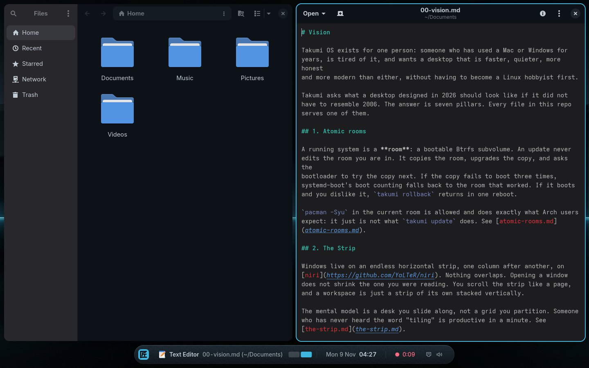 |
| A screenshot shows in the Core, a press away from opening | Recording: a red mark with the time; press it to stop |
| 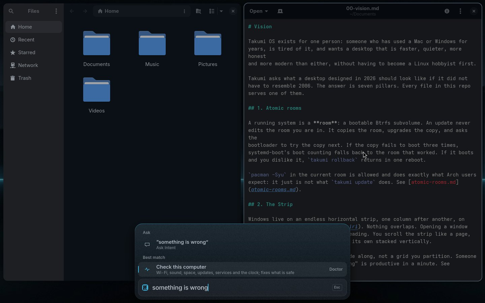 | 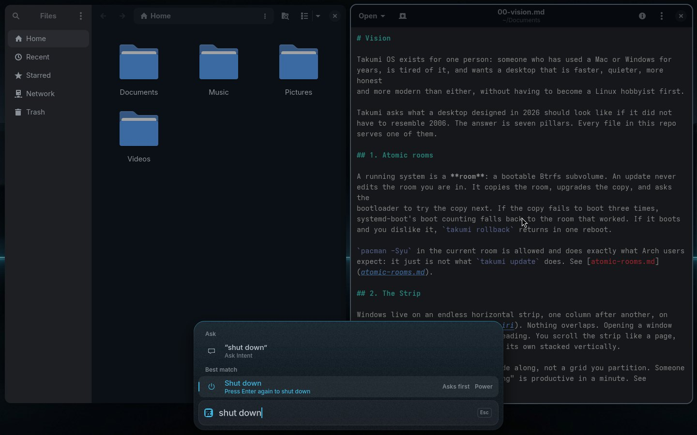 |
| "Something is wrong": the check that fixes what is safe | Risky rows ask in place: "Press Enter again to shut down" |
| 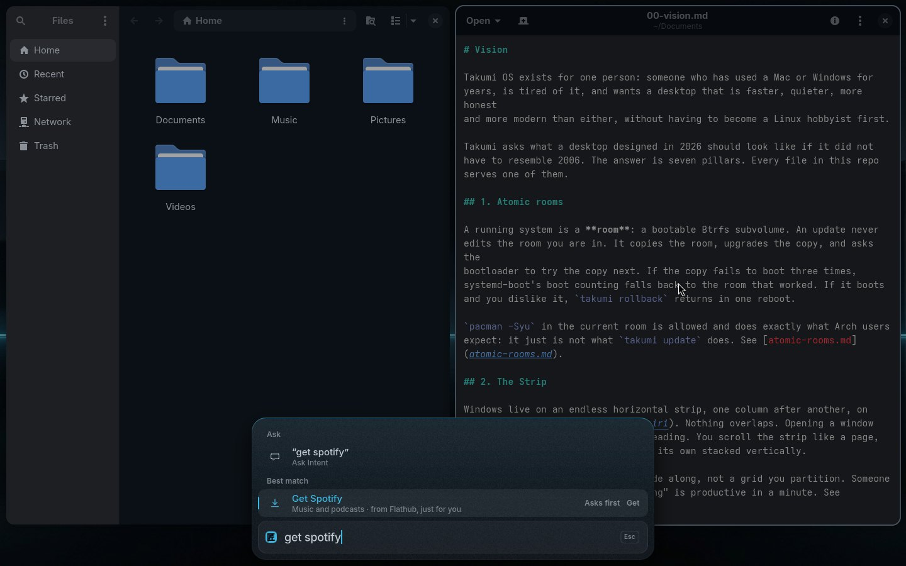 | 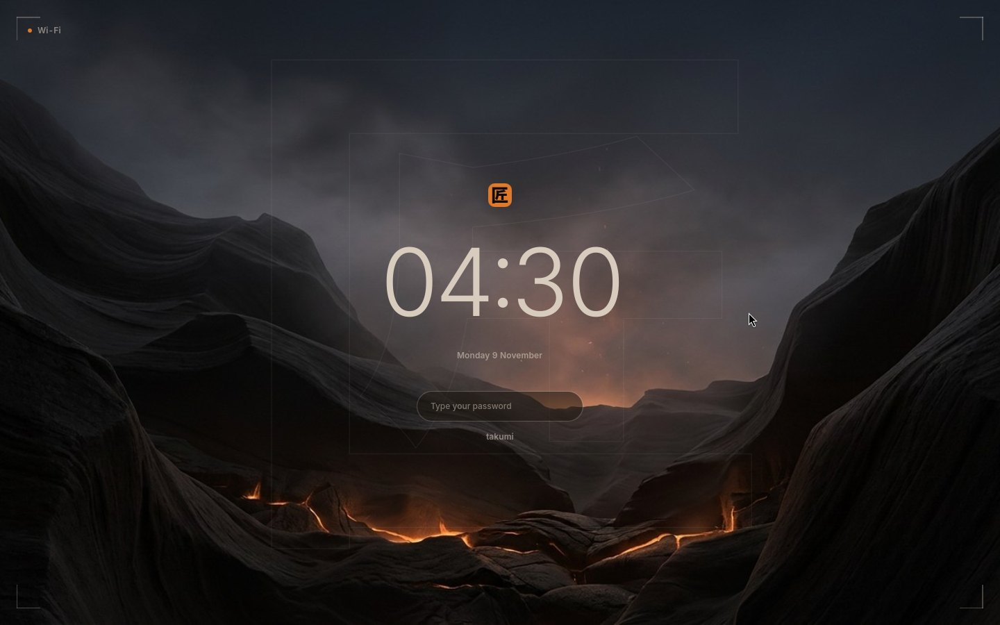 |
| The Shelf: apps by name, installed just for you | The lock screen in the ember theme |
| 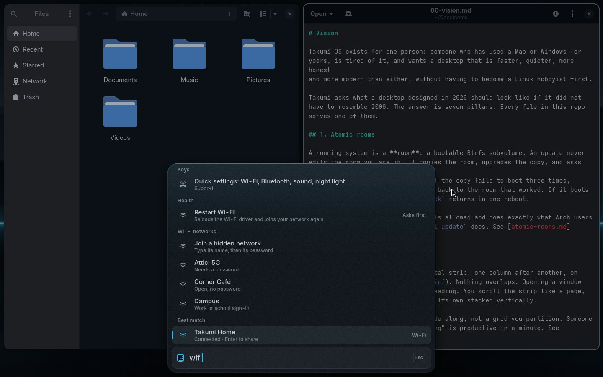 | 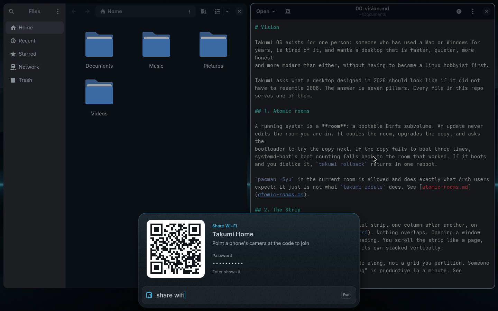 |
| Wi-Fi in the Core: the network you are on, saved ones, the rest | Enter on your network: a code a phone's camera scans to join |

## Status

`0.1.0`, pre-alpha. What is real today, tested in the VM:

- the installer, the login screen, the session, the shell (Sky, Core, Lock)
  and the Palette with apps, windows, settings, power, keys, themes, the
  Shelf and the first week's start rows
- atomic rooms end to end: an update builds a new room, a room that does not
  reach its login screen sends the computer back to the last good one on its
  own and says so at login, rollback by choice, pruning
- app notifications as Core notices, do not disturb, plain-word rows that
  ask in place instead of opening a terminal
- Wi-Fi in the Core, on simulated radios: join with the password typed in
  place (a wrong one is known in seconds), hidden networks, forget, share by
  a code a phone scans, and hotel sign-in pages that open by themselves
- password requests from the system in the Core, never a terminal; sound
  (where it goes, per-app volume, a mark while the microphone is in use);
  screens (bigger or smaller, turned, arranged, each change undone by itself
  unless kept); power profiles, idle times, low-battery notices
- Takumi's own boot: the 匠 splash, no menu, a quiet kernel, and the login
  screen rising out of the splash
- Quick settings and Today in the Core, a word under the pointer for every
  mark, marks for do not disturb, staying awake, the night light and a
  recording, the keyboard layout, and screen-reader names throughout
- capture without an app: screenshots shown in the Core, screen recording
  with a stop mark, a colour picker, text and QR codes read off the screen
- clipboard history and emoji in the Palette, one-time codes copied from a
  message, what apps said earlier
- Bluetooth in the Core with pairing that shows the code (against a fake
  BlueZ), `takumi doctor`, firmware through fwupd, and updates and rollback
  as conversations in the Core instead of a terminal
- fifty-five themes with phases: Takumi's own and the community palettes
  people already use

- the setup disc and disk encryption: install from the disc, one password
  from boot to desktop, a recovery code ([iso.md](docs/iso.md),
  [encryption.md](docs/encryption.md))
- for someone coming from a Mac or Windows: apps that open at login, closing
  apps before shutting down, force quit, zoom, remote help, the login keyring
  opened with your password, Free up space, restore points, update failures
  said in words, OneDrive, Google Drive and Dropbox as folders, writing a disk
  image to a USB stick, settings by topic and Help in the Palette, erasing the
  computer and setting one up for someone else

Not yet: real hardware (so no real Wi-Fi card or Bluetooth adapter yet), and
an x86_64 setup disc (the disc is built and tested for the ARM VM).
[docs/roadmap.md](docs/roadmap.md) has the order.

## Install

On a fresh Arch install, or from the Takumi ISO's live session:

```bash
curl -fsSL https://www.bakarimustafa.com/takumi/install.sh | bash
```

That downloads this repo to `~/.local/share/takumi` and runs
[`install/run.sh`](install/run.sh). Every step is a file under
[`install/steps/`](install/steps/), run in order, each one re-runnable.

## Documentation

Design and internals live in [`docs/`](docs/). Start with
[docs/00-vision.md](docs/00-vision.md), then:

- [docs/where-things-live.md](docs/where-things-live.md): what is in this repo, where it lands on disk, and what a home holds
- [docs/atomic-rooms.md](docs/atomic-rooms.md): the update and rollback model
- [docs/the-strip.md](docs/the-strip.md): the scrolling desktop
- [docs/palette.md](docs/palette.md): the one command surface
- [docs/wifi.md](docs/wifi.md): Wi-Fi in the Core: joining, sharing, sign-in pages
- [docs/harmony-keys.md](docs/harmony-keys.md): the universal Command key
- [docs/phase-themes.md](docs/phase-themes.md): themes that move with the clock
- [docs/intent.md](docs/intent.md): the assistant on Claude or OpenAI, its permission model, and `takumi mcp serve` for agents
- [docs/commands.md](docs/commands.md): how `takumi` finds and documents commands
- [docs/install-process.md](docs/install-process.md): the installer, step by step
- [docs/migrations.md](docs/migrations.md): per-user migrations
- [docs/design-language.md](docs/design-language.md): what Takumi looks like, and why
- [docs/shell.md](docs/shell.md): the Core, the Sky and the Lock: sizes, colour, motion
- [docs/vm.md](docs/vm.md): boot the real desktop in QEMU on a Mac
- [docs/testing.md](docs/testing.md): lint and tests
- [docs/roadmap.md](docs/roadmap.md)

The guide, for someone arriving from a Mac or a Windows PC, is in
[`guide/`](guide/): start with [your first hour](guide/your-first-hour.md).

## Contributing

Run `./test/run` before opening a pull request. Agents working in this repo
read [AGENTS.md](AGENTS.md) first.

## License

MIT. See [LICENSE](LICENSE).
