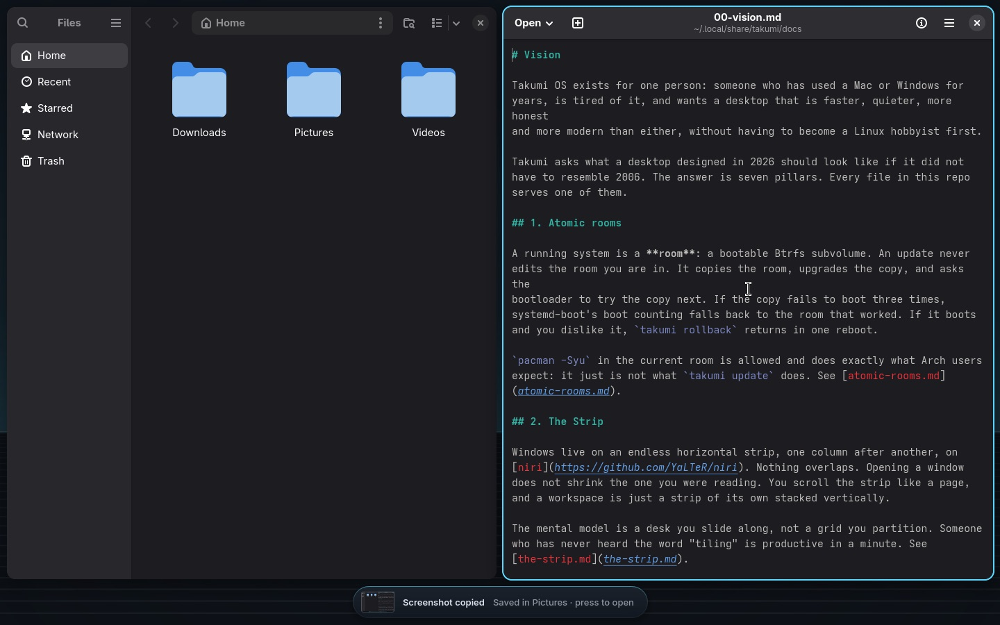

# Capture

Pictures, recordings, colours and words from the screen, without a separate
app. Every one of them is a key, a Palette row and a button in Quick settings,
and each ends with the Core saying what it did and offering to open it.



| To | Keys | Palette | Quick settings |
|---|---|---|---|
| picture an area | `Super+Shift+4` or `Super+Shift+S` | "Take a screenshot" | Screenshot |
| picture the screen | `Super+Shift+3`, `Print` | `takumi screen shot screen` | |
| picture a window | `Super+Shift+5` | `takumi screen shot window` | |
| mark up the last picture | Mark up, on the screenshot's notice | "Mark up the last screenshot" | |
| record, or stop | `Super+Shift+6` | "Record the screen" | Record, then Stop |
| copy a colour | | "Pick a colour" | Colour |
| copy the words in an area | | "Copy text from the screen" | Text |
| read a QR code on the screen | | "Read a QR code on the screen" | |

## Screenshots

niri draws the selection and saves the picture in `~/Pictures/Screenshots`
(`screenshot-path` in `config/niri/takumi/defaults.kdl`) and copies it. The
shell hears niri's `ScreenshotCaptured` event and the Core shows the picture,
small, with "Screenshot copied · Saved in Pictures": a press opens it in the
image viewer, and Mark up beside it opens it to draw on. `takumi screen shot
[area|window|screen]` does the same from a command.

## Marking up

Mark up opens the picture in satty, on the arrow tool, with boxes, circles,
lines, words, numbered markers, a highlighter, blur and crop beside it. Enter,
or Esc once no tool is in the middle of something, keeps the work: the
marked-up copy is saved beside the picture as "2026-11-09 10-00-00
marked.png" and copied, ready to paste into a message. satty's copy button
does the same, and its save button saves without copying. Closing the window
keeps nothing, and the screenshot itself is never changed. The Core then says "Marked up and
copied", and a press opens the copy.

"Mark up the last screenshot" in the Palette, or `takumi screen markup`,
opens the newest screenshot (never a marked-up copy); `takumi screen markup
<file>` opens any picture. `takumi screen shot --markup` takes the picture
and goes straight into marking it up, for a key of your own.

## Recording

"Record the screen" in the Palette asks what to take in, one step at a time:
"Record the computer's sound?", "And your microphone?", "And your camera?".
Each step adds one thing, so the first no ends the questions: no sound,
computer sound, computer sound and microphone, or all three. The next time the
first question is the last answer, "Computer sound and microphone, like last
time?", and one Enter starts. The Core closes and says "Drag over what to
record, or click a screen": drag over an area, or click to take a whole screen.
Esc gives up.

`Super+Shift+6` and Record in Quick settings ask nothing: they take in what
was chosen last, which starts as no sound.

While it records, the Core shows a red mark and how long it has been going,
and, with the microphone, the microphone's mark. Press the red mark,
`Super+Shift+6`, Stop in Quick settings, or the row again to stop. The Core
says "Saving the recording" while the sound is evened out, then how long it
was, and a press opens the file in `~/Videos/Recordings`. One recording runs at
a time.

What cannot be taken in is said when the recording starts, never as a failure:
a computer with no microphone records its own sound ("No microphone found, so
the computer's sound only"), a computer with no camera records without the
bubble, and a sound the recorder cannot open leaves the picture alone.

### Your camera

With the camera, a round bubble of you sits in the bottom right corner of what
is recorded, and it is recorded with the rest. It shows you as a mirror does.
Drag it anywhere inside the recorded area; the wheel over it, or `+` and `-`
once you have clicked it, makes it bigger or smaller; Esc hides it and lets
the camera go. It goes when the recording stops.

The bubble is `shell/Core/CameraBubble.qml`: one window on the overlay layer
(`takumi-camera`), as big as the screen it is on, clear, and taking input
only on the bubble, so the windows under it keep their clicks. Qt Multimedia
reads the camera, at the smallest picture of 360 lines or more the camera
offers, which is plenty for the bubble and light on the computer, and cuts it
to a circle on the GPU. Drawn without a GPU (a VM) it is a square inside the
ring. `takumi screen record` shows it through the shell's `camera` target
(`qs -c takumi ipc call camera show <x> <y> <width> <height>`, the area in the
layout's coordinates, and `hide`) a second before the recorder starts, so the
first frames have it. The shell loads the bubble apart from everything else
(`shell.qml`), so a computer without Qt Multimedia keeps its shell: the shell
answers "false", and the recording goes on without the bubble.

A camera is a video device that captures, as udev's `v4l_id` says
(`ID_V4L_CAPABILITIES=:capture:`): a laptop also lists metadata devices that
are no camera.

### How the sound is recorded

`wf-recorder` records the picture and one sound source, and keeps that source
in step with the picture.

- The computer's sound is the output in use, as the sound server's monitor of
  it (`pactl get-default-sink`, then `<name>.monitor`).
- The microphone is the input in use (`pactl get-default-source`). When the
  sound server offers an output's monitor there instead, there is no
  microphone.
- Both together go through a private output, "Recording"
  (`module-null-sink`, `takumi-recording`), that the computer's sound and the
  microphone are each looped into (`module-loopback`, 30 ms, both alike), and
  the recorder records that output's monitor. The modules are kept in
  `$XDG_RUNTIME_DIR/takumi-recording.parts` and unloaded, last first, when the
  recording stops; any a recording left behind are unloaded before the next.

Mixing the two after the recording, with ffmpeg's `amix`, was the other way.
It needs a second recorder for the second sound, started beside wf-recorder
but not with it, and nothing records when each began, so the voice would drift
off the picture and off the lips in the camera's bubble. One mixed source
keeps them together.

After the recorder stops, ffmpeg evens the sound out in place: one pass
measures it (`loudnorm`, EBU R128) and a second moves it to -16 LUFS, the
level podcasts and video sites play at, as one straight gain, so quiet and
loud moments keep their difference. The picture is copied untouched, the sound
written as AAC at 192 kb/s, and the file made to start playing before it has
all arrived (`+faststart`). Silence is left as it is, and so is the file when
anything fails.

The recording is known by `$XDG_RUNTIME_DIR/takumi-recording` ("pid, start,
file"), which the Core reads for its mark. What wf-recorder said last is in
`$XDG_RUNTIME_DIR/takumi-recording.log`. The last choice made in the Core is
`~/.config/takumi/capture.toml`:

```toml
sound = "both"   # none | computer | mic | both
camera = false
```

## Colours, words and codes

- **Pick a colour**: niri's own picker (`niri msg pick-color`). The hex code
  is copied and the Core shows the colour itself beside it.
- **Copy text from the screen**: drag over the words; `tesseract` reads them
  and they are copied. English unless `TAKUMI_OCR_LANGS` says otherwise
  (`eng+jpn`, with the matching `tesseract-data-*` package).
- **Read a QR code**: drag over a code; what it says is copied, and a link is
  offered to open.

## Codes in messages

When an app's message carries a one-time code ("Your verification code is
482913"), the notice in the Core has a **Copy 482913** button, so the code is
on the clipboard without opening the app. Resting the pointer on any notice
keeps it on screen.

## Remote help

Someone you trust can see your screen and use it from their computer, the way
a friend or a help desk would: type "remote help" (or "help me", "share
screen", "vnc") in the Core and choose **Let someone help remotely**. The Core
asks first ("Someone you trust will see this screen and can use its mouse and
keyboard until you stop it. Let them?"), then shows a card: where to connect
("Connect to 192.168.1.20", and the Tailscale address when Tailscale is on) and
a password made for this time alone, shown when you ask for it. The other
person opens a VNC viewer that speaks RSA-AES, such as TigerVNC 1.13 or later
or RealVNC Viewer, connects to that address as `help` with that password, and
sees the screen you were on. While it runs the resting Core shows a person;
it turns red while someone is connected. A press on it, or "stop remote help"
in the Core, stops it: the viewer is cut off, the password is forgotten and
the firewall closes again.

`takumi screen remote on` runs [wayvnc](https://github.com/any1/wayvnc)
(Arch's `extra` repository, installed with your password the first time, with
`openssh` for its key) as `takumi-remote`, a unit of your session that ends
with it. Its settings, an RSA key made for this time and the password live in
`$XDG_RUNTIME_DIR/takumi-remote.d/`, readable by you alone and in memory; the
password is never on a command line. It listens on port 5900 with wayvnc's
RSA-AES encryption and its own password check ([wayvnc's
manual](https://github.com/any1/wayvnc/blob/master/wayvnc.scd)). With the
firewall on, it asks for your password once more to let port 5900 in, by ufw's
"Remote help" profile (`etc/ufw/applications.d/takumi`), and closes it again
when it stops; while it is let in, "firewall" in the Core shows **Block Remote
help** ([firewall.md](firewall.md)), and nothing ever offers to allow it by
hand. wayvnc takes the picture through niri's wlr-screencopy and the other
person's hands through niri's virtual pointer and virtual keyboard.

`$XDG_RUNTIME_DIR/takumi-remote` holds wayvnc's process and when it started;
the Core reads it and asks wayvnc (`wayvncctl client-list`) whether someone is
connected. `takumi screen remote status` prints `on <started> <connected>` or
`off`.

## Commands

```
takumi screen shot [area|window|screen] [--markup]           a picture; --markup opens it to mark up
takumi screen markup [file]                                   mark up the newest screenshot, or a picture
takumi screen record [area|screen|stop] [--sound none|computer|mic|both] [--camera]
takumi screen colour | text | code
takumi screen remote <on|off|status>                          remote help: someone sees and uses this screen
```

`takumi screen record` without `--sound` or `--camera` takes in what was
chosen last; with either, exactly what they say (`--camera` alone records no
sound). Run from its row in the Core it asks first. Run while recording, it
stops.

| Command | Exit |
|---|---|
| `record` | 0 recording, or stopped and saved · 1 it could not record, or the recording did not save · 2 usage |
| `markup` | 0 marked up, or closed keeping nothing · 1 satty is missing · 2 usage · 3 no picture |
| `shot` | 0 taken, or nothing chosen · 1 niri did not take it · 2 usage |
| `remote` | 0 on (the card), or stopped · 1 it would not start · 2 usage · 3 no password · 4 you said no |

## Not yet

- A scrolling screenshot of a long page: no Wayland tool does it.
- Recording one window as it moves: wf-recorder records a screen or an area.
- Encoding on the GPU: the recorder uses the processor (x264).
- Following an output you switch to mid-recording: the computer's sound
  stays on the output that was in use when it started.
- Setting how loud the microphone is against the computer's sound: both go
  in at their own level.
- Trimming the ends of a recording.
- Remote help across the internet without Tailscale: the other person must be
  on the same network, or reach this computer through Tailscale. Viewers that
  speak only the old VNC password scheme (macOS's Screen Sharing, many phone
  apps) cannot connect, since that scheme sends the screen unencrypted.
- Asking before each connection: whoever has the password while it is on is
  let in, and the red mark says so.

## Testing

`test/capture` runs on any machine with fake tools: the recorder, slurp, the
sound server, udev's camera list, the shell, niri, ffmpeg and satty. It checks
what each choice takes in and how two sounds are mixed and taken apart, the
camera's bubble (and a screen left of the first), the questions the Core asks
and the answer it keeps, a recorder that cannot open the sound, stopping and
evening out the sound in place (silence and failures leave the file alone),
and marking up the newest screenshot, a name with % in it, and `shot
--markup` with and without niri's `--path`. Remote help is checked in
`test/firewall`, beside the fake ufw it opens and closes: the question, the
card and its password (never on a command line, in a folder only you can
read), wayvnc started for the session on the screen in use, the firewall let in
and closed again, someone connected, the rows, and wayvnc that would not
start.

The code: `lib/capture.sh`, `commands/screen/*`, `shell/Core/CameraBubble.qml`,
and in the shell `Core/Notice.qml` and `Sources/CoreState.qml` (the
screenshot's notice), `Core/Rest.qml` (the red mark) and `Core/Quick.qml`
(the capture buttons).
