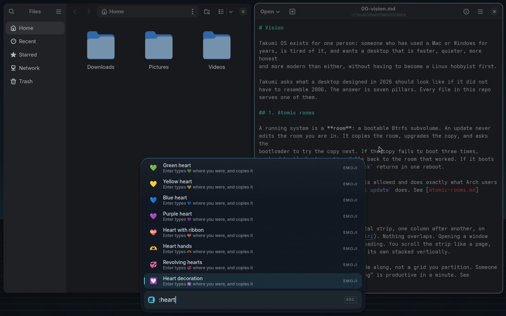

# takumi doctor

"Something is wrong" is a sentence people type. `takumi doctor` (the Palette
row "Check this computer", found by "doctor", "fix", "broken", "slow",
"something is wrong") checks what usually is, fixes what is safe to fix, and
says what it did in one sentence. In the Core it is a conversation: one note
per check while it works, then the sentence; at a terminal it prints the same
lines.



| Check | Fine | Fixed by itself | Said to you |
|---|---|---|---|
| Internet | "Online" | Wi-Fi left off is switched on | a sign-in page in the way, a network that does not answer, no network |
| Sound | "Sound works" | a stopped sound service is restarted | no output at all, sound muted |
| Space | "50 GB free" | under 5 GB: old downloaded packages are removed (asks for the password in the Core) | still under 5 GB: "Free up space" ([updates.md](updates.md)) |
| Updates | "Updated 3 days ago" | | more than 30 days: "update" brings it up to date |
| Services | "Every service is running" | | the ones that stopped, by name |
| Clock | "The clock is right" | set to follow the network (asks for the password) | |
| Battery | "The battery holds 80% of what it did when new" | | under 70%: it lasts less and can be replaced |
| This computer | "Takumi's fixes for this computer are in place, and no firmware is missing" | | fixes this room lacks ("update" sets them up), firmware the kernel looked for ([hardware.md](hardware.md)) |

The sentence is "All fine: …", "Fixed 1; the rest is fine", or "2 need you:"
and the first of them. The report is kept in `~/.local/state/takumi/doctor.txt`
(one line per check: ok, fixed or needs), and the Palette's "Last check" row
opens it.

## Restarting one thing

When one thing stops working, a row restarts just that, in the Core, and
says what it did in one sentence. "fix" or "restart" lists all four; "no
sound", "wifi not working" or "bluetooth not working" finds the one.

| Row | What happens | Said |
|---|---|---|
| Restart Wi-Fi | the wireless card's driver module, found through `/sys/class/net/<card>/device/driver/module`, is unloaded and loaded again with the modules that hold it (iwlmvm on iwlwifi) through `modprobe`, then `nmcli radio wifi on`; a driver built into the kernel, or one too busy to unload, restarts NetworkManager instead. Asks for the password | "Wi-Fi restarted (its driver was reloaded) and joined Corner Café" |
| Restart Bluetooth | `bluetooth.service` is restarted (asks for the password), then each paired device you trusted is connected again | "Bluetooth restarted; AirPods connected again" |
| Restart sound | your `pipewire`, `pipewire-pulse` and `wireplumber` services | "Sound restarted and plays on Built-in Audio; an app that was playing may need to start again" |
| Restart the desktop | `takumi-shell.service`, the Core, the Sky and the Lock, without ending the session; apps stay open | "The desktop is restarting; it is back in a moment, with your apps still open" (said first: the Core is what restarts) |

```
takumi doctor restart <wifi|bluetooth|sound|desktop>
```

Exit status: 0 done · 2 usage · 3 nothing here to restart (no Wi-Fi card,
Bluetooth not set up, no takumi-shell.service) · 1 it did not come back.

## The internet's speed

"speed" or "internet slow" finds "Test the internet speed"
(`takumi doctor speed`). In the Core it notes each step and ends with one
sentence: "Download 94 Mbit/s · Upload 21 Mbit/s · 18 ms". It takes about
20 seconds.

It uses curl alone, against Cloudflare's speed test
(`speed.cloudflare.com/__down` and `/__up`), so nothing is installed:
librespeed-cli is only in the AUR, and Arch's `speedtest-cli` reaches
Ookla's servers through an interface Ookla does not document. The time an answer takes is the quickest of
five connections. Download and upload each fetch or send 25 MB at a time
for about 10 seconds, and the speed is what moved over the time it took.
The last result is kept in `~/.local/state/takumi/speed.txt`, and the
Palette shows it as "Last speed test: …"; Enter tests again. Exit status:
0 measured · 1 the internet did not answer.

## Testing

`test/doctor` runs every case against a fake computer: the checks, the four
restarts against a fake `/sys/class/net` (`TAKUMI_NET_SYS`), sudo, modprobe,
NetworkManager, BlueZ and PipeWire, and the speed test against a fake curl
(`TAKUMI_SPEED_URL`, `TAKUMI_SPEED_SECONDS`).
