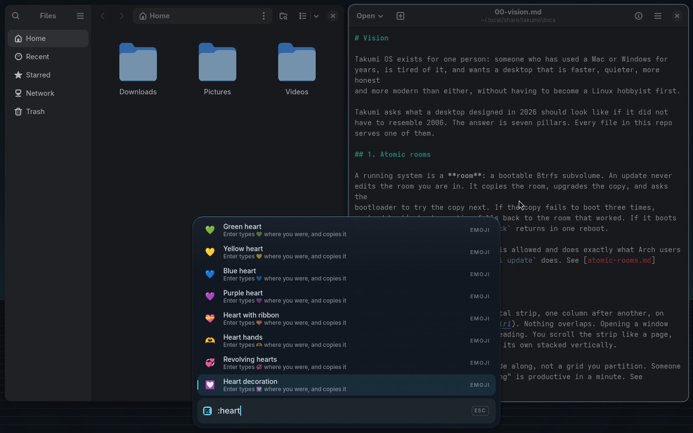

# Palette

The Palette is Takumi's one command surface. `Super+Space` opens it over
whatever you are doing. You type, a ranked list appears, `Enter` acts,
`Escape` leaves. There is no app launcher, no settings app, no network menu
and no run dialog, because the Palette is all of them.

## Providers

Every row comes from a provider. A provider prints rows as JSON lines:

```json
{"id":"app:firefox","title":"Firefox","subtitle":"Web browser","icon":"firefox","keywords":"browser web","run":["gio","launch","/usr/share/applications/firefox.desktop"],"score":1}
```

The built-in ones are cases of `commands/palette/index <provider> <query>`,
plus two answered inside the shell:

| Provider | Rows | Weight |
|---|---|---|
| `apps` | installed `.desktop` entries, Flatpak apps included | 1.0 |
| windows | open windows, by title and app (from niri, in the shell) | 1.0 |
| `commands` | every `takumi` command in plain words: power, toggles, update, rollback; the settings by topic and Help (below) | 0.8 |
| `keys` | the keys worth knowing: "screenshot" shows `Super+Shift+3` | 0.75 |
| `shelf` | apps you can get by name from Flathub ("Get Spotify"), web apps ("Get Outlook") and what you can remove: `takumi app shelf` | 0.7 |
| `wifi` | nearby networks and what to do with them, see [wifi.md](wifi.md) | 0.9 |
| `themes` | switch theme (shown on the shell while selected), pin a phase | 0.7 |
| `clipboard` | what you copied, newest nearest the field, only for "clipboard", "paste", "copied" or "history" | 0.95 |
| `emoji` | emoji and symbols by name: all of them after ":" or "emoji", the three best under any other search | 0.9 |
| `calc` | arithmetic through `qalc`; Enter copies the answer | 1.1 |
| `start` | the empty Palette: the first week's "Start here" rows, then always Settings and Help | 1.0 |
| `bluetooth`, `sound`, `display`, `power`, `earlier`, `doctor`, `firmware`, `security`, `keyboards`, `language`, `time`, `hardware`, `defaults`, `backup`, `phone`, `vpn` (and the firewall), `printer` (and scanners), `drives`, `fonts`, `login` (apps that open at login), `quit` (force quit or restart an app), `remote` (remote help), `settings` (one app's settings back) | everyday settings, each its own `commands/palette/<name>` | 0.8 to 0.9 |
| intent | the typed sentence, for a query with a space (in the shell) | 0.3 |

Your own providers go in `~/.config/takumi/palette/<name>` (any executable).
Each is called with the query as `$1` and prints the same JSON lines.

Fields a row can carry:

| Field | Means |
|---|---|
| `id`, `title`, `subtitle` | who it is and what it says |
| `icon` (apps) or `glyph` | an app icon name, or a stroke icon from `shell/Look/Icons.js` |
| `keywords` | more words it answers to |
| `run` | the command Enter runs, as an argument list |
| `risk` | above 0, Enter asks in place first |
| `interactive` | runs in a terminal, because it asks questions |
| `preview` | 16:9 thumbnail image path (`sample.png`, themes) |
| `swatch` | colours to show when a theme has no `preview` image |
| `char` | a character to show instead of an icon (emoji) |
| `bars` | Wi-Fi strength, 1 to 3, drawn as the icon |
| `steady` | keeps the provider's order: no boost from how often you picked it |
| `converse` | `run` is a conversation: it runs inside the Core and talks through `lib/core.sh` |
| `card` | `run` prints a card to show in place of the rows |
| `search` | words Enter types into the field instead of running `run` (Settings and its topics); `run` does the same through the shell's IPC, for a shell that does not know `search` |
| `refresh` | seconds; the provider runs again that often while its rows are on show |

## Settings by topic, and Help

The empty Palette ends with two rows, under **Find your way**:

- **Settings** types `settings` into the field, which lists the topics, for
  someone who does not know the word to type: Wi-Fi, Bluetooth, Sound,
  Displays, Keyboard & mouse, Power & battery, Look, Apps, Privacy &
  security, Backups, and Help. Each says what is in it while it shows, and
  Enter types its own word (`wifi`, `bluetooth`, `sound`, `display`,
  `keyboard`, `power`, `theme`, `app`, `security`, `backup`) into the field,
  where that topic's rows are. "preferences", "control panel" and "options"
  list them too; a search for one topic ("wifi") does not.
- **Help** opens the guide (`guide/`) in the browser. "help", "guide" or
  "manual" find it too.

The guide is Markdown in the tree; `install/steps/50-user.sh` renders each
page to HTML at `/usr/share/takumi/guide/` (`README.md` is `index.html`)
with a small converter of its own for what the guide uses (headings,
paragraphs, lists, tables, code, bold, links between its pages), so opening
it needs nothing beyond the browser. In a checkout without an install, Help
opens `guide/README.md`.

## Clipboard history and emoji



`takumi-clipboard.service` keeps what you copy, text and pictures, the last
200, in `cliphist`. A password manager marks its copies sensitive and those are
never written down (`commands/clipboard/keep`). The history shows only when
you ask for it, `Super+P` or typing "clipboard", "paste", "copied" or
"history" (more words narrow it), so a copy never turns up under another
search. Enter puts the copy back and pastes it into the app you were in, with
the paste key `Super+V` sends, which works in the terminal too. "Clear the
clipboard history" asks first.

`Super+.`, `Super+;` and `Super+Ctrl+Space` open the Core on ":", which lists
emoji and symbols by name (1,774 of them, from Unicode's own names, the popular
ones first and answering to everyday words: "lol", "thanks", "party"). Enter
types the emoji where you were and copies it. Any other search of three
letters or more shows the three best at the bottom: "fire" finds 🔥 under
Firefox.

## Matching and ranking

Every word of the query must appear somewhere in a row's title, subtitle or
keywords, ignoring case and hyphens: "wifi off" finds "Turn Wi-Fi off",
"turn off wifi" too.

A row's score is the provider's score times its weight, plus a boost: the
query starts the title or a word of it (0.5), starts one of its keywords
(0.45), every word of a longer query is in the title (0.4), or the title
holds the query (0.3). Each time you pick a row it gains 0.05, from
`~/.local/state/takumi/palette/history`, unless it is steady. Intent's row
never takes a boost: its title is the query itself, and it stays the
fallback, so a sentence never comes back with "no results".

## Your apps, without typing

The empty Palette has a row of app tiles between the rows and the field: the
apps you open most, then the everyday ones (Firefox, Files, Terminal, Text
Editor, Writer, Celluloid) until your own use takes over, then **All apps**.
`Down` from the nearest row reaches it and `Left` / `Right` move along it.

Typing `apps` (or `all apps`, `applications`) shows every app as a grid of
icons, A to Z. The arrow keys move through it, `Enter` or a click opens one,
and typing on finds an app by name instead, or offers to get one. Both read the
same list as the App provider (`takumi palette index apps`), so they leave out
helper entries the same way, and an app you open from them counts towards the
row like one opened from a search. That list honours override files the way
every desktop does: one in `~/.local/share/applications` replaces the system
entry of the same name, and `Hidden=true` there removes it.

## Keys inside the Palette

| Keys | Does |
|---|---|
| `Enter` | Run the selected row (a row that asks: the first Enter arms it, the second runs it) |
| `Ctrl+Enter` | Run and keep the Palette open |
| `Up` / `Down` | Move away from / towards the field; results stack upward. From the nearest row, `Down` reaches the app row |
| `Left` / `Right` | Move along the app row, or through the grid of every app |
| `PageUp` / `PageDown` | Six rows at a time |
| `Alt+1..9` | Run the nth row (`Super+1..9` stays with niri's workspaces) |
| `Ctrl+U` | Clear |
| `Escape` | Clear, then close |

Two moments borrow the Palette:

- **A conversation**, such as joining a Wi-Fi network. Only the row it is
  about stays, and a second field asks what the command needs; what you type
  there never reaches a provider. `Enter` answers, `Escape` clears, then
  stops. See "Conversations" in [shell.md](shell.md) and `lib/core.sh`.
- **A card**, such as sharing a network. It takes the rows' place. `Enter`
  shows or hides its secret, `Escape` goes back, typing searches again.

## Why one surface

Most desktops have a launcher, a menu, a bar with panels, and a settings
hierarchy. Takumi collapses them because a person leaving macOS already
knows one gesture, `Cmd+Space`, and reaches for it for everything. Making
that gesture answer everything is the single biggest "this is better"
moment in the first ten minutes.

## Implementation

The Palette is the Core's open state (`shell/Core/Open.qml`): it grows out of
the capsule rather than appearing as a window. `shell/Core/Providers.qml`
runs each provider as a `Process`, debounced at 40 ms under a generation
counter, and merges the rows as they arrive. Sizes, colours and motion are
in [shell.md](shell.md).
