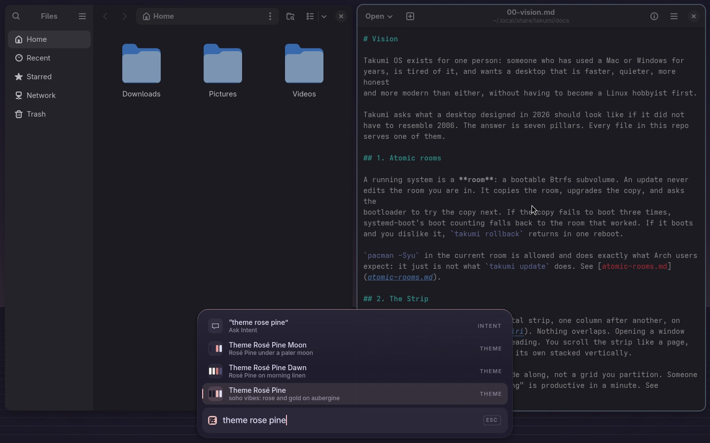

# Phase themes

A Takumi theme is a palette plus four phases. The desktop moves through the
phases with the clock, so a late-night screen is not the same screen as a
midday one.

## Theme shape

```
themes/<name>/
  theme.toml          required
  sample.png          optional: a 16:9 picture of the theme for its Palette row
  skies/              optional pictures for the Sky: default.*, or one per phase (dawn.*, day.*, ...)
```

`theme.toml`:

```toml
[meta]
name = "ion"
mode = "dark"            # dark | light; apps that only know two modes use this
title = "Ion"            # optional: the name the Palette shows
about = "electric blue on near-black, the default"   # optional: one line of mood
credit = "…"             # optional: whose palette it follows, with a link
glass = true             # optional: foot and GTK windows slightly see-through over the sky

[palette]                # the day palette; every key is required
accent      = "#5ad7ff"
background  = "#0b0f14"
surface     = "#111821"
foreground  = "#d9e2ec"
muted       = "#5c6b7a"
red         = "#ff6b81"
yellow      = "#ffd166"
green       = "#7ee787"
cyan        = "#5ad7ff"
blue        = "#6ea8fe"
magenta     = "#c792ea"

[phase.dawn]             # optional; keys override [palette] during that phase
accent     = "#ffb080"

[phase.dusk]
accent     = "#ff9f6e"

[phase.night]
background = "#06090d"
foreground = "#c2cad3"
accent     = "#3fb6e0"
```

A theme with no `[phase.*]` tables is a static theme and is perfectly valid.

Your own themes live in `~/.config/takumi/themes/<name>/`, shaped the same,
and win over Takumi's of the same name. `takumi theme from <picture>` makes
one from a photo's colours, with the photo as its sky ([look.md](look.md)),
and `takumi theme check <name>` shows each phase's contrast: text at 4.5:1 or
better against the background and the surface, the accent at 3:1 or better.

## The clock

`~/.config/takumi/phase.toml` holds the schedule and your overrides:

```toml
[schedule]
dawn  = "05:30"
day   = "08:00"
dusk  = "17:30"
night = "20:30"

[override]
# phase = "night"      # pin a phase; "auto" or missing follows the clock
```

`takumi phase tick` runs from a systemd user timer every 10 minutes and at
login. It computes the phase, and if it changed, re-renders the theme and
notifies the shell. The shell crossfades over 1.5 seconds; nothing flashes. Choosing
a theme is the one moment that is not quiet: the Sky opens along its horizon
(see [shell.md](shell.md#the-sky)).

Night light (colour temperature, via `wlsunset`) is tied to the same
schedule, so one file controls both.

## Rendering

`takumi theme render` takes the theme name and the phase, merges
`[palette]` with `[phase.<name>]`, and draws the look into
`~/.local/state/takumi/look/`:

- `palette.toml`, the merged palette, which the Quickshell shell watches;
  written whole and last, after the app files and the sky picture, so the
  shell never reads half a palette or a new palette with the old picture
- one file per template in `default/app-colours/`, with `{{accent}}`-style
  tokens replaced (`foot-theme.ini`, `niri-theme.kdl`, `gtk.css`, `btop.theme`,
  `nvim-theme.lua`, `fontconfig.conf`, `firefox-userChrome.css`,
  `starship.toml`); `{{accent:bare}}` is the colour without its `#`, for
  apps that take `RRGGBB`, like foot. Besides the palette, `{{mode}}`,
  `{{name}}`, `{{phase}}` and `{{glass}}`, a template can use `{{opacity}}`
  (0.92 when the theme asks for glass, else 1.0) and your fonts from
  `~/.config/takumi/shell.toml` ([look.md](look.md)): `{{font_ui}}`,
  `{{font_mono}}`, `{{font_size}}` (the Core's, 13 as drawn) and `{{font_pt}}`
  (the point size apps take for it, 11 at 13). A file is replaced only when
  its text changes, so apps that watch one are not woken at every phase
- the `sky` symlink: `skies/<phase>.*` (image extensions only) if the theme has one,
  else `skies/default.*`; if the theme has no pictures, any stale `sky` link is removed

A template is the app's own file with `{{tokens}}` in it, named as the file
it becomes. Yours in `~/.config/takumi/app-colours/` are rendered first and win
over a built-in with the same name. Seeded app configs (`config/gtk-3.0/gtk.css`,
`config/gtk-4.0/gtk.css`, `config/btop/`, `config/nvim/plugin/takumi-theme.lua`) read those
rendered files directly.

After rendering, `takumi theme apply` reloads foot (`SIGUSR1`), niri
(`niri msg action load-config-file`), GTK (`gsettings`), QML (`qs`), points
Takumi's icon theme at the Papirus folder colour nearest the theme's day
accent, keeps the browsers wired when you asked for that ([look.md](look.md)),
copies palettes and the optional sky picture to `/var/lib/takumi/greeter/`
for the login screen, and runs `~/.config/takumi/on/theme-change` if it exists.

## The Sky and theme previews

Each theme carries a 16:9 `sample.png` shown inline in the Palette when you
browse themes (`theme`). When a theme ships image files in `skies/`
(as all seventeen Takumi-native themes do), `look/sky` is displayed on
the Sky and login screen with the same 1.5 s crossfade and live hover preview.

When a theme does not ship images, `shell/Look/Sky.js` paints the screen
deterministically from the theme's name, full palette, luminance and the
clock across six landscape scenes (monolith bay, alpine ridges, orbital wave
plane, coastal pier, bamboo grove and stratified dunes) with a sun/eclipse by
day and a starlit crescent with aurora at night. See [shell.md](shell.md#the-sky).

## Shipped themes

Fifty-five themes ship, light and dark, each with its four phases and a
`sample.png` thumbnail; Takumi's seventeen native themes also ship bespoke
16:9 wallpapers in `skies/default.jpg`. Moving through them in the Palette
(`theme`, or a theme's name) shows each one live on the shell and the Sky before
you choose it; Esc puts yours back, Enter chooses it and recolours every app.



Takumi's own:

| Name | Mood | Mode |
|---|---|---|
| **ion** | electric blue on near-black, the default | dark |
| **ember** | warm amber and rust | dark |
| **kiln** | paper and clay in daylight | light |
| **void** | monochrome near-black, one quiet accent | dark |
| **beni** | safflower crimson on lacquer | dark |
| **fuji** | wisteria at dusk | dark |
| **hinoki** | pale cypress wood and moss | light |
| **kintsugi** | charcoal mended with gold | dark |
| **kuro** | high contrast on black, for the clearest reading | dark |
| **matcha** | whisked green tea in a dark bowl | dark |
| **sakura** | cherry blossom on a spring morning | light |
| **shiro** | high contrast on white, for the clearest reading | light |
| **sumi** | ink stone black, paper white and a vermilion seal | dark |
| **umi** | the deep sea and its teal glow | dark |
| **washi** | handmade paper, ink and indigo | light |
| **yoru** | a clear night and its stars | dark |
| **yuki** | fresh snow under a clear sky | light |

From community palettes, kept as their authors made them and given Takumi's phases: a warmer accent at
dawn and dusk from the palette's own oranges, a deeper, quieter night. In the day palette, body text is
held at 7:1 or better against the background, quiet text and the accent at 3:1, so a few colours sit a
shade off their originals; in every phase of every theme, body text stays at 4.5:1 or better
(`test/themes` checks both).

| Name | Mood | Mode | Colours after |
|---|---|---|---|
| **ayu-dark** | bright gold on near black | dark | [Ayu by dempfi](https://github.com/ayu-theme/ayu-colors) |
| **ayu-light** | Ayu's orange on clean white | light | [Ayu by dempfi](https://github.com/ayu-theme/ayu-colors) |
| **ayu-mirage** | Ayu softened onto blue-grey | dark | [Ayu by dempfi](https://github.com/ayu-theme/ayu-colors) |
| **catppuccin-frappe** | muted pastels on slate | dark | [Catppuccin](https://catppuccin.com) |
| **catppuccin-latte** | pastel ink on cool paper | light | [Catppuccin](https://catppuccin.com) |
| **catppuccin-macchiato** | pastels, a little brighter than Mocha | dark | [Catppuccin](https://catppuccin.com) |
| **catppuccin-mocha** | soothing pastels on a deep blue-grey | dark | [Catppuccin](https://catppuccin.com) |
| **dayfox** | Nightfox's daylight sibling | light | [Nightfox by EdenEast](https://github.com/EdenEast/nightfox.nvim) |
| **dracula** | vivid purples and pinks after midnight | dark | [Dracula by Zeno Rocha](https://draculatheme.com) |
| **everforest** | soft greens of a forest at dusk | dark | [Everforest by sainnhe](https://github.com/sainnhe/everforest) |
| **everforest-light** | forest greens on sunlit paper | light | [Everforest by sainnhe](https://github.com/sainnhe/everforest) |
| **flexoki** | inky, paper-born colour for reading | dark | [Flexoki by Steph Ango](https://stephango.com/flexoki) |
| **flexoki-light** | ink on warm paper, made for reading | light | [Flexoki by Steph Ango](https://stephango.com/flexoki) |
| **github-dark** | the colours of code review at night | dark | [GitHub's Primer colours](https://primer.style/foundations/color) |
| **github-light** | the colours of code review | light | [GitHub's Primer colours](https://primer.style/foundations/color) |
| **gruvbox** | retro warmth: cream on brown-black | dark | [Gruvbox by morhetz](https://github.com/morhetz/gruvbox) |
| **gruvbox-light** | retro warmth on old paper | light | [Gruvbox by morhetz](https://github.com/morhetz/gruvbox) |
| **iceberg** | cool, quiet blues of deep water | dark | [Iceberg by cocopon](https://github.com/cocopon/iceberg.vim) |
| **kanagawa** | Hokusai's wave: ink, foam and indigo | dark | [Kanagawa by rebelot](https://github.com/rebelot/kanagawa.nvim) |
| **kanagawa-dragon** | Kanagawa in dark ink and ash | dark | [Kanagawa by rebelot](https://github.com/rebelot/kanagawa.nvim) |
| **kanagawa-lotus** | Kanagawa on aged rice paper | light | [Kanagawa by rebelot](https://github.com/rebelot/kanagawa.nvim) |
| **light-owl** | Night Owl's daytime twin | light | [Night Owl by Sarah Drasner](https://github.com/sdras/night-owl-vscode-theme) |
| **melange** | warm, earthy, easy on the eyes | dark | [Melange by savq](https://github.com/savq/melange-nvim) |
| **night-owl** | for those who code late into the night | dark | [Night Owl by Sarah Drasner](https://github.com/sdras/night-owl-vscode-theme) |
| **nightfox** | a fox's night: teal and soft blue | dark | [Nightfox by EdenEast](https://github.com/EdenEast/nightfox.nvim) |
| **nord** | arctic frost blues on polar night | dark | [Nord by Arctic Ice Studio](https://www.nordtheme.com) |
| **one-dark** | the editor classic: calm blues on charcoal | dark | [One Dark and One Light from Atom](https://github.com/atom/atom/tree/master/packages/one-dark-syntax) |
| **one-light** | the editor classic in daylight | light | [One Dark and One Light from Atom](https://github.com/atom/atom/tree/master/packages/one-dark-syntax) |
| **oxocarbon** | IBM Carbon's colours, cool and exact | dark | [Oxocarbon by nyoom-engineering](https://github.com/nyoom-engineering/oxocarbon.nvim) |
| **poimandres** | minimal, with mint and ice | dark | [Poimandres by drcmda](https://github.com/drcmda/poimandres-theme) |
| **rose-pine** | soho vibes: rose and gold on aubergine | dark | [Rosé Pine](https://rosepinetheme.com) |
| **rose-pine-dawn** | Rosé Pine on morning linen | light | [Rosé Pine](https://rosepinetheme.com) |
| **rose-pine-moon** | Rosé Pine under a paler moon | dark | [Rosé Pine](https://rosepinetheme.com) |
| **solarized** | precise, balanced colour on deep teal | dark | [Solarized by Ethan Schoonover](https://ethanschoonover.com/solarized/) |
| **solarized-light** | Solarized on warm cream | light | [Solarized by Ethan Schoonover](https://ethanschoonover.com/solarized/) |
| **tokyo-day** | Tokyo Night's blues by daylight | light | [Tokyo Night by folke](https://github.com/folke/tokyonight.nvim) |
| **tokyo-night** | neon city blues on midnight | dark | [Tokyo Night by folke](https://github.com/folke/tokyonight.nvim) |
| **tokyo-storm** | Tokyo Night under a softer, stormy sky | dark | [Tokyo Night by folke](https://github.com/folke/tokyonight.nvim) |

## Why phases instead of a light/dark toggle

A light/dark toggle is a binary that gets flipped twice a year. The
interesting variable is time of day, and once a theme knows about it the
"dark mode" question answers itself: `kiln` is light and still gets a gentle
night, `ion` is dark and still gets a warm dawn.
