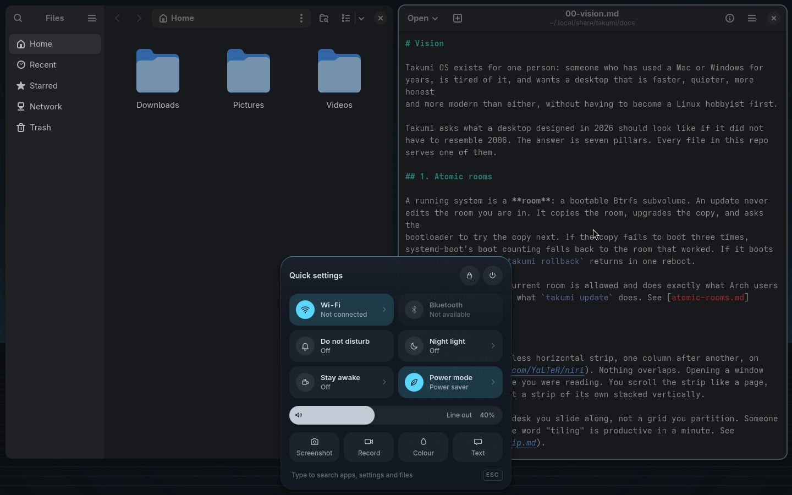
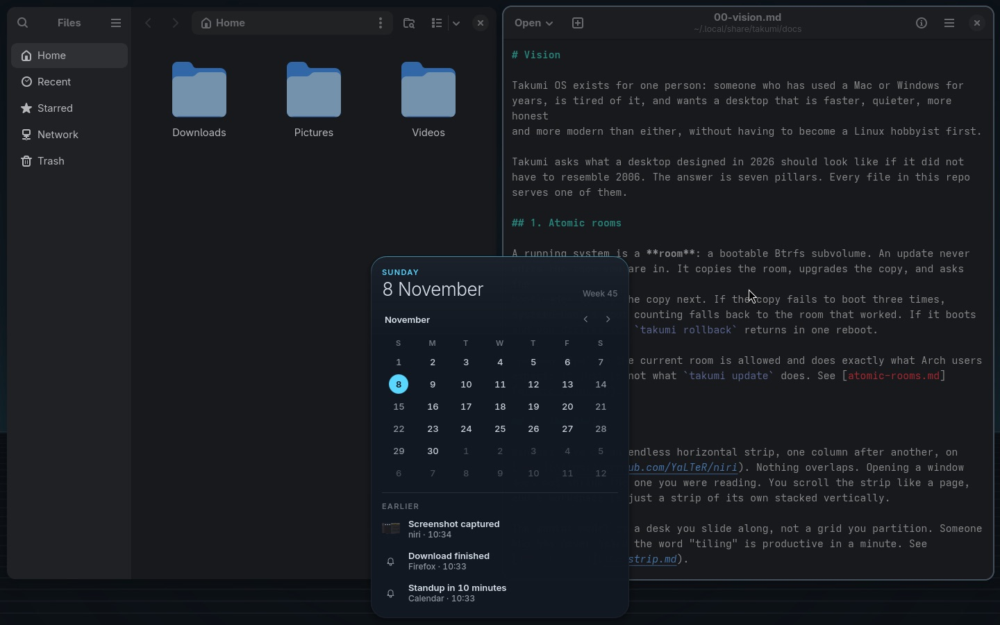

# The shell

One Quickshell instance, `shell/shell.qml`, started by `takumi-shell.service`
at login. It draws three things and nothing else:

- **the Sky**, the background of every screen
- **the Core**, the only object on top of your windows: status at rest, a
  notice for a moment (including messages from apps), the Palette when you ask,
  Quick settings from its status marks and Today from its clock
- **the Lock**

Before login, `shell/greeter.qml` draws the **login screen**: the same Lock
face on the same Sky, run by greetd.

This page is the contract for anyone touching `shell/`. The principles behind
it are in [design-language.md](design-language.md).

## Layout of `shell/`

```
shell.qml             creates the services once and hands them to every screen
Look/Style.qml        every size, alpha and duration; nothing else holds a number
Look/Theme.qml        the colour roles, read from the rendered theme
Look/Icons.js         one stroke icon set, 24 grid, paths only
Look/Sky.js           the sky painter (the preview paints the same scene)
Sources/Niri.qml      one `niri msg --json event-stream`: workspaces, windows, layouts, focus
Sources/Poll.qml      battery, volume, network (link, signal, sign-in pages), the modes and what is running (dictation, a timer, remote help) every 10 s, never overlapping
Sources/CoreState.qml where the Core is open, its starting query, and its notices: Takumi's own and the queue of apps' messages
Sources/Notices.qml   the notification server: apps' messages, written to notices.jsonl; do not disturb
Parts/                Label, Icon, SignalIcon, Emblem, Pressable, Arrival, Trace (the light along the Core's top edge as it opens)
Sky/                  Sky.qml (background layer surface), SkyCanvas.qml (the painting)
Core/                 Core.qml, Rest.qml, Segment.qml, Notice.qml, Open.qml, ResultRow.qml, Providers.qml, Card.qml, Scrim.qml,
                      AppGrid.qml (the app row and the grid of every app), Quick.qml with Tile.qml, Level.qml and
                      NowPlaying.qml (Quick settings), Today.qml, Zoom.qml (the magnifier docked at the top, docs/accessibility.md)
Parts/LockFace.qml    the emblem, time, date and field the Lock and the login screen share
Parts/Arrival.qml     the login screen's first moment: the boot splash's picture, then the tile rising onto the emblem
Lock/Lock.qml         session lock and PAM
greeter.qml           the login screen (greetd, through commands/greeter/main in cage)
setup.qml, Setup/     the setup disc's screens ([setup.md](setup.md))
```

## The Core

One capsule per screen, bottom centre, floating one gap above the edge and
reserving its height plus that gap. It is a single shape with five states,
and it moves between them by morphing (width and height on a 300 ms spring,
the radius easing from half its height to 22). Each time it opens, a line of
the accent runs from the middle of its top edge out to both corners and fades
(`Parts/Trace.qml`), as if it grew out of the horizon; rows come in one after
another from the field up, and Quick settings' tiles in a wave from the top left:

| State | Shows | Size |
|---|---|---|
| **Rest** | emblem · the app you are in and its window's title ("Search" with nothing open) · the strip's columns when there are two or more · workspace numbers when there is more than one · what is playing · date and time · background apps · a recording in progress (red, with its time; a press stops it) · remote help (a person; red while someone is connected; a press offers to stop it) · dictation listening (the microphone, breathing; a press stops it) · a running timer (what is left; a press opens Today) · microphone and camera · the keyboard layout when there is more than one (a press goes to the next) · the modes you turned on (do not disturb, staying awake, the night light) · network (in words when something is in the way) · battery · volume; each part shows only with something to say, lights under the pointer and has a word above it | as wide as its content, 46 tall |
| **Notice** | an icon, a title, a detail, and a meter, a code to copy or an app's buttons; "3 more" when others wait | as wide as the notice, 46 tall; 1.8 s for Takumi's own, 5 s for a message (8 with buttons) |
| **Palette** | results stacked upward, Intent's plan, the field | 640 wide, as tall as its content (200 to 440) |
| **Quick settings** | six switches (Wi-Fi, Bluetooth, do not disturb, night light, stay awake, power mode), the sound and, with a backlight, brightness; what is playing; the lock, and the four ways to stop | 420 wide, as tall as its content |
| **Today** | the day, the month, what apps said earlier | 372 wide, as tall as its content |

Rest details:

- **Workspaces** are numbered pills, the one you are on in the accent; only
  the one you are on and those with windows get a number. Click one to go, or
  turn the wheel over them to go up and down.
- **The strip minimap** draws one block per column of the active workspace,
  as wide as the column is on screen (a full-width column is 56 px), when
  there are two or more. The focused column is lit. Click a block to focus
  that column.
- **Numbers** are measured against their widest value ("100%") so the
  capsule never shifts as they change.
- When the focused column fills the strip (maximized or fullscreen), the
  Core slides below the edge and gives its space back.

Notices replace popups and the on-screen display. Any command can send one:

```bash
takumi notice vol Volume "" 40
takumi notice sun Theme ember
```

Volume, brightness, theme, phase and the toggles already do. A notice shows
on the focused screen and never interrupts an open Core. A fifth argument
holds it longer, for something worth reading: `takumi notice restart "Update
undone" "…" -1 10`.

**Messages from apps.** The shell is the desktop's notification server. A
message widens the Core with the app's own icon, the summary and the first
line of the body, for five seconds, eight when it carries the app's own
buttons (up to three, at the right end). Others wait behind it, newest
first, and "3 more" brings the next; several from one app are one notice
with their number on the icon. An urgent message stays until you put it
away. A press runs the app's default action, the right button puts the
notice away, `Super+Shift+Space` acts on it from the keyboard (or copies its
one-time code), `Super+Alt+Page Down` and `Page Up` go back and forth
through the ones waiting, and `Super+Escape` puts every notice away. Links in
a message open in the browser. Takumi's own
notices show over messages, which come back after them, and nothing counts
down while the Core is open or the pointer rests on it. While do not
disturb is on (`takumi switch dnd`) messages are counted instead of shown,
urgent ones aside, and turning it off says how many came in. When one of
your apps crashes, the Core says so, with See why and Copy details. See
[notifications.md](notifications.md).

**The status marks are one door.** The modes, the network, the battery and
the speaker together open Quick settings, and the wheel over them turns the
sound up or down. The network mark is Wi-Fi with one to three arcs lit by
signal, a socket on a cable, or Wi-Fi struck through with no network, and it
takes the accent when a sign-in page or a broken network stands in the way
([wifi.md](wifi.md)). A mode you turned on shows a quiet mark while it lasts:
a struck bell for do not disturb, a cup while staying awake, a crescent for
the night light. The clock opens Today; the power key opens the Palette on
"power". The same works from anywhere, and `Super+I` opens Quick settings:

```bash
qs -c takumi ipc --any-display call core quick
qs -c takumi ipc --any-display call core today
qs -c takumi ipc --any-display call core search power
```

**A word under the pointer.** Rest the pointer on a part of the Core for
450 ms and a word appears above it: what it is and what it holds ("Wired ·
Sound 40%", "Sunday 8 November 2026", a tray app's own title). Moving along
the Core changes the word instead of hiding it. The word sits outside the
Core's input mask, so it never takes a click. Screen readers get the same
words: every part, switch, level and row has an accessible name and role.

Open details:

- Results stack upward from the field, best match nearest your hands. Up
  moves away from the field, Down towards it.
- The empty Palette holds a row of app tiles above the field: the apps you
  open most, then **All apps**. Down from the nearest row reaches it, Left and
  Right move along it. Typing `apps` shows every app as a grid of icons
  (`AppGrid.qml`, [palette.md](palette.md)).
- Each row has an icon (the app's own icon for apps and windows, a 16:9
  `sample.png` thumbnail for shipped themes or a 4-bar swatch fallback, a
  bare stroke icon, or Wi-Fi signal bars), the title with the matched text
  lit, "Asks first" for anything above risk tier 0, the kind, and, while Alt
  is held, its Alt+number. While you browse (nothing typed) a row is its
  title alone, 38 px; with a search its subtitle comes back under it, 44 px,
  where it tells results apart. A row that is armed, working or failed always
  says so.
- Selection is the foreground at 0.09 plus a 2 px accent rail: the rail is
  the only accent. It never changes the text colour.
- For a sentence of three or more words, Intent's plan appears above the
  field after a 600 ms pause: the exact `takumi` lines it would run
  (`takumi intent --plan`). `intent_preview = false` in
  `~/.config/takumi/shell.toml` turns that off, for example when you would
  rather not spend a request on every pause.
- Rows read in plain words. A command can carry `title=`, `words=` (search
  words: "shutdown turn off"), `glyph=` (its stroke icon) and
  `interactive=yes` in its metadata (see [commands.md](commands.md)).
  Commands that need an argument are reached through their own rows (a theme
  row, not "takumi theme set"), and internal ones never show.
- **Nothing asks in a terminal unless it must.** A row above risk tier 0 asks
  in place: the first Enter arms it ("Press Enter again to shut down", in the
  accent), the second runs it, and moving away disarms it. Only commands
  marked `interactive=yes` (an update, installing software) open a terminal,
  because they ask questions or need your password.
- Enter runs the selected row. Enter with no rows asks Intent. Ctrl+Enter
  runs and stays open. Esc clears, then closes. Super+1..9 belongs to
  niri's workspaces, so rows use Alt+1..9.
- **A conversation happens in the Core.** A row marked `converse` runs its
  command inside the Core with `TAKUMI_CORE=1`. The command speaks one line
  at a time (`lib/core.sh`): `ask`, `secret` and `confirm` put a question in
  a second field (a lock in place of the emblem for a secret, Show at the
  right end, "Enter for yes, Esc for no" for a confirm); `note` is shown
  under the row while it works; `wrong` shakes the field, outlines it red and
  empties it; `done` closes the Core and says the text as a notice. The answer
  leaves the field the moment Enter sends it, so a secret is never on screen
  while the command works. Typed text never reaches the providers. Esc with an
  empty field stops the command; Esc while it works closes the Core and lets
  it finish, and a notice says how it ended.
- A question is always readable in full: the conversation's row wraps its
  words onto up to four lines and the Core grows to fit. A question that has
  just appeared ignores Enter for 600 ms, so the Enter that started the
  command, pressed twice, cannot also answer it. Answering "no" is a choice,
  not a failure: if the command then stops, its last words stay in the
  ordinary colour and Enter starts it again.
- **A card shows one thing in place of the rows**: a code to scan beside a
  title, a line of detail and a secret that shows only on Enter. The first
  card shares the Wi-Fi network you are on (`takumi wifi share --card`).



Quick settings details:

- The switches show what `takumi switch state` says (one JSON line): when it
  opens, every 3 s while it is open, and 1.2 s after a press. A press shows
  its result at once, and a read that started before the press is dropped.
- A press switches a tile by running the same command a Palette row runs
  (`takumi switch wifi`, `takumi power awake 60`, `takumi power profile`…).
  A tile's icon stands bare; on, the tile is tinted and the icon is in the
  accent. The arrow at a tile's end (shown while the pointer is on the tile),
  or the right button, opens the Palette on its
  topic: "wifi", "bluetooth", "night light", "power". Power mode steps
  through the modes the computer has.
- A switch that cannot work here (no Bluetooth service, no power profiles)
  says "Not available" and greys out.
- The sound level drags, clicks, wheels and steps with the arrow keys; its
  icon mutes. Brightness shows only with a backlight: external monitors answer
  too slowly over DDC/CI to follow a drag, so they keep their keys and the
  Palette's display rows ([display.md](display.md)).
- While a player has a song (MPRIS), a card under the levels shows its cover,
  the song, who made it and the player, with back, play or pause and next,
  and a hairline along its bottom for how far along it is (`NowPlaying.qml`).
- The power button turns the switches into Sleep, Restart, Shut down and Log
  out; the three that close your apps ask for a second press.
- Tab moves between switches and levels, Space or Enter switches, Right opens
  a switch's topic, Esc closes. Typing anything opens the Palette with what
  you typed.



Today details:

- The month starts on your locale's first day, today in the accent, the ISO
  week beside the date. The arrows, Page Up and Page Down or the wheel page
  through months; Home or the Today button comes back.
- Under it, the last three messages apps sent this session, newest first
  (`Sources/Notices.qml` keeps fifty; every one is also in
  `~/.local/state/takumi/notices.jsonl`).

Surfaces: the Core's surface sits on the overlay layer, is as tall as its
tallest open shape (`coreSurface`), is transparent, and is masked to the
capsule, so clicks elsewhere reach your windows. Its exclusive zone is the rest height plus one gap. While open
it takes exclusive keyboard focus, and a separate full-screen scrim on the
top layer dims the windows and closes the Core on click. The shadow is drawn
by the shell, so niri's layer shadows are off for `takumi-*` namespaces.

## The Sky

When a theme ships image artwork in `skies/`, the shell renders
`look/sky` (or `Theme.previewWallpaper` while previewing a theme in
the Palette) over each screen. Otherwise `shell/Look/Sky.js` paints a
deterministic scene from `Theme.name`, the rendered palette (core roles plus
`red`, `yellow`, `green`, `cyan`, `blue`, `magenta`), light/dark luminance and
the clock across six landscape motifs:

- a two-stop sky and horizon bloom seeded from the surface, background and
  secondary palette accents
- a disc or subtle eclipse in the accent (or ringed orb on orbital scenes)
  that rises at the left at dawn, crosses, and sinks behind the horizon at
  dusk; at night on dark themes, a crescent among stars and soft aurora rays
- a theme-seeded foreground/midground horizon (monoliths on the shore, layered
  alpine ridges, topographic wave planes, coastal piers, mist-draped bamboo or
  stratified dunes)
- a framing vignette calibrated separately for light and dark themes

It follows `~/.config/takumi/phase.toml`. A pinned phase puts the disc at a
fixed point for that phase. A new phase or a preview crossfades over 1.5 s: the
previous sky or image is captured, held on top, and faded once the next one is
ready. Choosing a theme opens instead: the captured scene parts along its
horizon (where `Sky.js` painted it, `horizon()`; three fifths down for a
picture), its two halves drawing away up and down over about a second with a
line of the new accent and its glow on each edge, the new sky underneath, and
the Core's light runs in the new colour at the same moment. Choosing the theme
you were previewing ends the preview at once and plays the same opening over
it. With reduced motion every change is instant. The disc moves on its own
every five minutes.

## The login screen

`greetd` runs `takumi greeter` as the greeter user: cage (a one-window
compositor) showing `shell/greeter.qml`, which is the Lock face on the Sky
for the person who owns the computer (the first account with a home in
`/home`). A good password starts the session with `takumi session start`.

The greeter cannot read your home, so whenever your theme changes,
`takumi theme apply` keeps a copy of its four phase palettes, any per-phase or
default `background` image, and your phase clock in `/var/lib/takumi/greeter/`
(writable by the wheel group). The login screen wears your theme and wallpaper
at the right phase. The installer turns greetd on only when no other login
manager is enabled.

The first login screen since the computer started opens on the boot splash's
picture, drawn where plymouth draws it, and the tile rises onto the emblem as
the sky comes up; the time, the date and the field follow (`Parts/Arrival.qml`,
[boot.md](boot.md)). After a logout it only fades in. The sky is painted
behind that first picture, so it comes as soon as the window does, and the
login screen's compiled QML and shaders are kept in `/var/cache/takumi/greeter`.
Its messages go to the journal (`journalctl -t takumi-greeter`).

The login screen also counts as "reached a usable screen" for a room on its
first start (see [atomic-rooms.md](atomic-rooms.md)).

## The Lock

`takumi lock` (Super+L) asks the shell to lock with the Wayland session lock
protocol. Each screen gets the sky and the Lock face (`Parts/LockFace.qml`):
the emblem, the time at up to 150 px, the date, one field, and the user name, in front of 匠 drawn as a faint
outline most of the screen tall. As it appears, a thin mark draws out from each corner of the screen; inside the
top left one, how the computer is connected (Wi-Fi, Wired or Offline, "no internet", the VPN). Typing goes
straight to the field.
When what you type comes out in capitals without Shift, "Caps Lock is on" takes the user name's place. Along
the bottom: what is playing, with play and pause, and at the right the keyboard layout (when there is more
than one; a press goes to the next, so the password goes in the layout it was made in) and the battery.
PAM checks it through `/etc/pam.d/takumi-lock` (the `login` stack). A wrong
password shakes the field and outlines it in red.

If the shell dies while locked, niri keeps the session locked. Switch to a
TTY, run `systemctl --user restart takumi-shell`, then lock again from the
session to get the field back. `takumi lock` falls back to `swaylock` when the
shell is not answering.

## Scale

`Style.space(px)` is the only way to size anything. It multiplies by the font
scale (`font_size / 13` from `~/.config/takumi/shell.toml`) and rounds, so a
larger text size gives a roomier shell, not a cramped one.

| Token | Value |
|---|---|
| gap | 10, niri's layout gap |
| coreHeight, coreRadius, coreOpenRadius | 46, 23, 22 |
| coreOpenWidth, coreOpenMin, coreOpenMax | 640, 200, 440 |
| quickWidth, todayWidth, coreSurface | 420, 372, 560 |
| tileHeight, tileRadius, levelHeight, dayCell | 58, 16, 34, 32 |
| field, rowHeight (searching / browsing), iconSlot, previewSlotWidth | 52, 44 / 38, 30, 50 |
| cardHeight, qrTile, qrRadius | 196, 168, 14 |
| micro / caption / body / subtitle / title | 12 / 12 / 14 / 15 / 18 |

## Colour

The shell uses six UI roles (`accent`, `background`, `surface`, `foreground`,
`muted`, `red`), while `Theme.qml` also reads `yellow`, `green`, `cyan`,
`blue` and `magenta` for the procedural Sky. Every tint is an alpha of the
foreground over the surface:

| State | Alpha |
|---|---|
| hover / selected / pressed fill | 0.05 / 0.11 of the accent / 0.14 |
| the Core's fill, at rest / open | 0.94 / 0.985 of the surface (open, window edges must not show through) |
| a switch, off / on | 0.055 / 0.17 of the accent |
| field fill | 0.06 |
| hairline / top highlight | 0.11 / 0.07 |
| dim / micro / faint text | 0.62 / 0.45 / 0.40 |
| scrim | 0.30 of the background |

The same numbers serve kiln (light) and void (black); there is no light or
dark branch anywhere in the QML. The one exception to the palette is a code a
phone camera reads: it is always near-black on white (`codeInk`,
`codePaper`), so every camera reads it in every theme. The unlit arcs of the
Wi-Fi mark are its colour at 0.22.

## Motion

Entrances and exits 167 ms on a decelerating curve, hover and press 83 ms,
things already on screen moving point to point in 167 to 333 ms (the values in
`Look/Style.qml`, after Windows' motion guidance:
https://learn.microsoft.com/windows/apps/design/signature-experiences/motion).
The Core's morph is 333 ms on a slight spring. Retints are 1.5 s.
Press scale is 0.975, and the hit area counter-scales so a press near an edge
still lands. Something in progress breathes (a row's rail, 760 ms each way)
or sweeps (the field's line, 1.1 s a pass).

A few moments are allowed to be a show, each short and played once: the
Core's light running along its top edge as it opens (0.8 s), rows and Quick
settings' tiles arriving one after another (18 ms apart), the Lock's corner
marks drawing out and its great 匠 coming up (0.9 s), a level notice lighting
its segments, and the Sky opening along its horizon when you choose a theme
(1.15 s).

`reduce_motion = true` in `shell.toml` zeroes every duration and stills all
of it. **Animations** in the Palette (`takumi switch motion`) sets it together
with niri's own `animations { off; }`, so windows and the Core stop moving at
once ([accessibility.md](accessibility.md)). Drawn without a GPU (a VM without 3D), nothing moves continuously and
no glow is drawn; the moments above still play, as they move only lines and
clipped pictures. Shadows are pre-rendered pictures (`Look/shadow-near.png`,
`Look/shadow-far.png`), the same with or without a GPU.

## Rules

- No pixel numbers outside `Style.qml`. No colours outside `Theme.qml`.
- Every Text is a `Label`: PlainText unless the caller escapes its own
  markup, as the result title does for its highlight.
- Icons are strokes from `Icons.js` or the app's own icon. No glyph fonts.
- Any process a surface runs has a running check so two never overlap, and a
  generation counter so a late result for an old query is dropped.
- Parsing errors (JSON, the theme file) keep the previous value.
- `test/qml` checks that every token, theme role, icon and component the
  shell uses exists.
