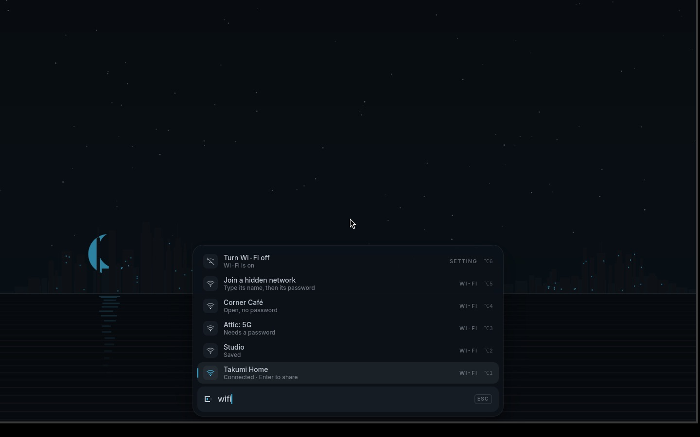
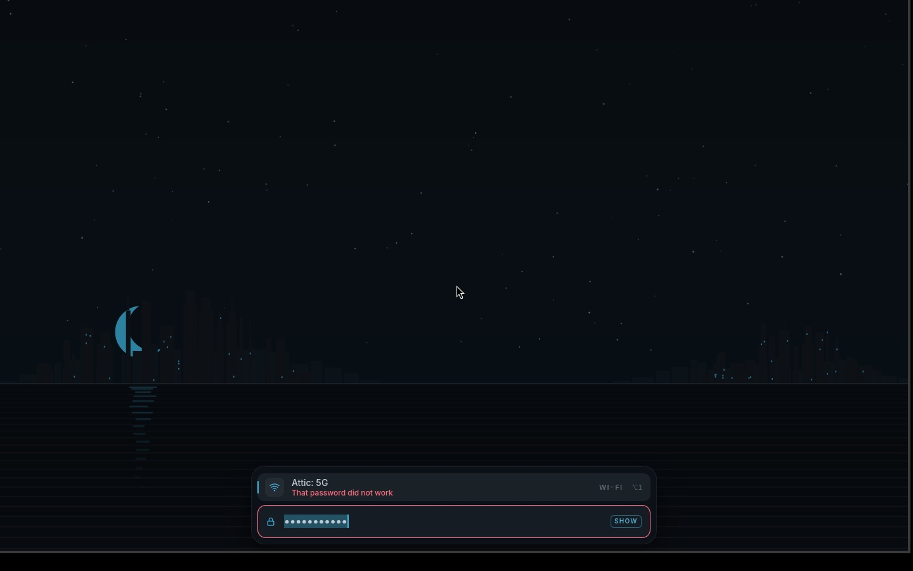
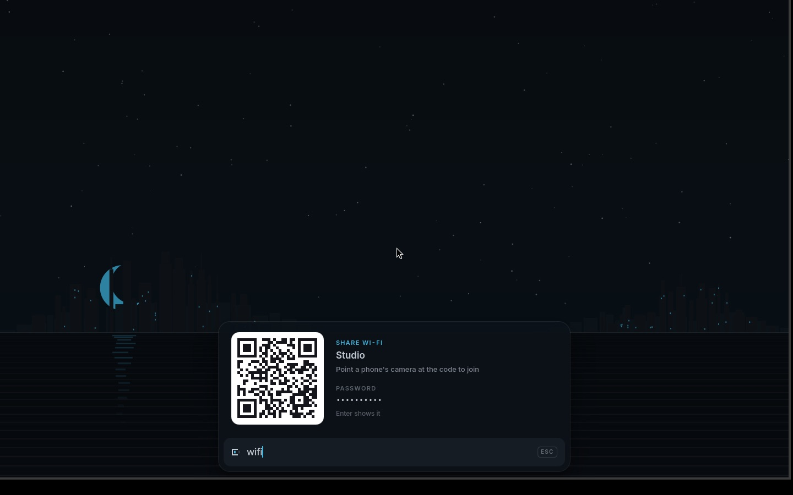

# Wi-Fi

Wi-Fi lives in the Core, like everything else. There is no network menu and
no settings window. Type "wifi" (or "network", or "internet"), or click the
Wi-Fi mark in the resting Core, and the Palette lists what is nearby.



## What you see

The rows read from the field upward:

1. The network you are on: "Connected · Enter to share".
2. Saved networks nearby: "Saved". Enter joins without asking.
3. Every other network, strongest first: "Needs a password", "Open, no
   password", "Work or school sign-in". A weak one adds "weak signal".
4. "Join a hidden network", then "Turn Wi-Fi off" at the top.

Each network's icon is its signal: three arcs, with the missing ones dimmed.
The list keeps this order whatever you picked most often, and a fresh scan
runs while it is open (at most every 20 seconds). If you moved to a row, it
keeps your selection when the list updates.

Three letters of a network's name find it from anywhere ("corner" finds
"Corner Café"), and every word counts: "wifi off" finds "Turn Wi-Fi off".

## Joining

Enter on a network runs `takumi wifi join` as a conversation in the Core.
Only that network's row stays, and when the network needs a password the
field under it asks "Password for Corner Café"; what you type shows as dots.
Show, at the field's right end, shows it as you type.

Enter joins. The row says "Joining Corner Café…" in the accent and a short
line sweeps along the field. Then one of three things happens:

- **It joined.** The Core closes and says "Connected to Corner Café". The
  network is saved and joins by itself from now on.
- **The password was wrong.** The field shakes, turns red and empties, the
  row says "That password did not work", and it asks again. Nothing is saved
  until a password works.
- **Something else.** The row says what, in words: not nearby, no address
  from the network, no answer in time. Enter tries again; Esc goes back.



A wrong password is known in about ten seconds, not after a long timeout.
Esc while joining closes the Core; joining goes on, and a notice says how it
ended.

A hidden network asks for its name first, then its password (Enter with no
password joins an open one).

## Work and school networks

eduroam and other networks that sign you in with a username (WPA2 or
WPA3-Enterprise) say "Work or school sign-in". Enter asks three things, one
after another, in the Core:

1. "Username for eduroam": at a school, usually your email address there.
2. "Password for eduroam", as dots.
3. The domain of the network's server. When the username has one
   ("ada@uni.example"), Enter takes it: "Server domain, or Enter for
   uni.example". Otherwise: "Server domain, from your IT department's Wi-Fi
   page", where it is given as the server's name or its certificate's, such
   as radius.uni.example.

The server's certificate must come from an authority this computer trusts
(the system's list, `/etc/ssl/certs/ca-certificates.crt`) and belong to that
domain. That is what keeps a network that only looks like eduroam from
collecting your password. Takumi offers PEAP or TTLS, whichever the server
asks for, with MSCHAPv2 inside, which covers eduroam and most offices.

When it does not join, wpa_supplicant's log says why, and the row says it
in words:

- "eduroam's certificate is not for uni.example": the domain is asked again.
- "That username or password did not work": both are asked again, and Enter
  keeps the username.
- "eduroam's certificate is not from an authority this computer trusts: ask
  your IT department": the network uses an authority of its own, which
  Takumi cannot add yet.

A saved work or school network whose password changed asks for the new one.

## Sharing

Enter on the network you are on opens a card: a code a phone's camera reads
to join, and the password, hidden until you press Enter. Esc goes back.
"share wifi" finds the same card from anywhere.



The code is the standard `WIFI:` text phone cameras understand, drawn dark on
light whatever the theme. A hidden network's code says so.

## Sign-in pages

Hotel, café and airport networks often want you to accept terms on a web
page first. NetworkManager notices (its connectivity check finds a page in the
way), the shell sees that within ten seconds, and `takumi wifi signin --auto`
says "Sign in to Corner Café" and opens the page in your browser, once per
network per hour. Until you sign in, the Wi-Fi mark is the accent colour and
the network's row says "Connected · sign in to use the internet"; Enter on it,
or typing "hotel", opens the page again.

The page opened is NetworkManager's own check address, which the network
answers with its sign-in page. Arch turns the check on
(`/usr/lib/NetworkManager/conf.d/20-connectivity.conf`).

## Steady on the charger

While the computer is plugged in, the Wi-Fi card's power saving is off, so a
call or a game does not stutter when the card would doze between packets.
On battery it is on again, where it saves power. Nothing to choose: a
desktop, with no battery, keeps it off.

NetworkManager's own setting (`wifi.powersave`) is one choice per network,
not per power source, so Takumi sets the card itself with
[`iw dev <card> set power_save on|off`](https://wireless.docs.kernel.org/en/latest/en/users/documentation/iw.html),
from one script, `default/networkmanager/dispatcher.d/80-takumi-wifi-power`
(installed in `/usr/lib/NetworkManager/dispatcher.d/`), run two ways:

- by udev when a charger comes or goes
  (`default/udev/80-takumi-wifi-power.rules`: a `power_supply` of type Mains
  or USB, added or changed): every Wi-Fi card;
- by NetworkManager's dispatcher when a Wi-Fi card comes up, since a driver
  may turn its power saving back on as it connects: that card.

Plugged in means a Mains or USB power supply is online, or there is no
battery. `iw` is in the base packages.

## The resting mark

| Mark | Means |
|---|---|
| Wi-Fi, 1 to 3 arcs | joined, by signal |
| A socket | on a cable |
| Wi-Fi, struck through | no network |
| Any of them in the accent | connected, but a sign-in page or a broken network is in the way |

## Commands

The Core runs these; they work at a terminal too.

```
takumi wifi list [--json] [--rescan]   nearby networks, the one in use first
takumi wifi join <name> [--hidden]     join; the password (and at work or school the username and the
                                       server's domain) comes on stdin or is asked for
takumi wifi forget <name>              forget a saved network (asks first in the Core)
takumi wifi share [name] [--card]      the password and a code a phone can scan
takumi wifi signin [--auto]            open a hotel or café sign-in page
takumi switch wifi                     the radio, on or off
```

`takumi wifi join` is a conversation (`lib/core.sh`): in the Core it asks for
the password in place and asks again after a wrong one; at a terminal it
prompts; fed by a pipe it reads answers line by line (at work or school: the
username, the password, then the domain, an empty line taking the one in the
username). For scripts, its exit
status says what happened and its last line says it in words:

| Exit | Means |
|---|---|
| 0 | joined |
| 3 | an answer was needed and none came (no password given, or the saved one stopped working) |
| 4 | that password (or that username) did not work, or cannot be right (WPA wants 8 to 63 characters) |
| 5 | not nearby |
| 6 | a work or school network whose server could not be checked: its certificate is for another domain, or from an authority this computer does not trust |
| 1 | anything else |

## How a password travels

A password never goes on a command line, where any user can read it in the
process list:

1. The Core writes it to `takumi wifi join`'s stdin when the command asks.
2. The command creates the network's profile without it, then hands it to
   nmcli's editor on stdin (`set 802-11-wireless-security.psk …`, `save`).
3. It activates the profile with nobody standing by to answer for secrets,
   so a wrong password fails in seconds instead of being asked again and
   again until a timeout.
4. A network that never joined is deleted, so a wrong password is never
   kept. A joined one is set to join by itself from then on.

A work or school password travels the same way (`set 802-1x.password …`).
The username and the domain are no secrets and go as arguments.

`takumi wifi share` reads the password back with `nmcli -s` and gives it to
`qrencode` on stdin and to `jq` through the environment, which only you can
read.

Two things nmcli does not offer were tried and dropped: a password file
(`passwd-file`) and nmcli's own asking (`--ask`) both answer every retry with
the same wrong password, so a typo costs a minute; `--ask` from a pipe also
prepends the old password to the new one.

**Saved for everyone, or just for you.** An administrator at the computer
saves networks for everyone, so the computer is online at the login screen
too (Arch's polkit rule for NetworkManager allows this for the `wheel` group
on a local session). Anyone else saves them just for themselves
(`connection.permissions user:…`), which needs no password.

## Not yet

- Work and school networks whose server's certificate comes from an
  authority of their own (a certificate file from the IT page, or an eduroam
  CAT installer), and those that want TTLS with PAP, EAP-TLS with a
  certificate of yours, or a hidden name.
- Passwords that start or end with a space: nmcli's editor drops those
  spaces.
- Making a hotspot, and choosing among several Wi-Fi adapters.

## Testing

- `test/wifi` runs on any machine with a fake `nmcli`: names with colons,
  accents and a trailing colon, hidden and duplicate networks, every row the
  Core shows, every exit code, the conversation's lines in the Core, work and
  school networks (the three questions, a wrong password, a certificate for
  another domain or from an unknown authority, as wpa_supplicant writes them
  down), and that no password reaches any command's arguments.
- `test/system` runs the power-saving script against a fake `iw` and a fake
  `/sys`: off on the charger (a USB-C one too), on on battery, off on a
  desktop, only Wi-Fi cards, only the events it is for.
- `test/vm wifi` gives the VM five real networks on simulated radios
  (`mac80211_hwsim`), in a namespace of their own with internet through the
  VM's cable: Takumi Home (WPA2), Corner Café (open), Attic: 5G (WPA3),
  Studio (hidden) and Campus (work or school: PEAP with MSCHAPv2 from
  hostapd's own sign-in server, its certificate from an authority the rig
  makes and adds to the VM's trusted list). The passwords and Campus's
  username are in `install/vm/wifi-rig.sh`. `test/vm wifi portal` makes them
  all seem to want a sign-in page; `test/vm wifi no-portal` undoes it. See
  [vm.md](vm.md).

The code: `lib/wifi.sh`, `commands/wifi/*`, the `wifi` case of
`commands/palette/index`, and in the shell `Core/Open.qml` (the question,
joining, the card), `Core/Card.qml`, `Parts/SignalIcon.qml` and
`Sources/Poll.qml` (the mark, sign-in pages).
